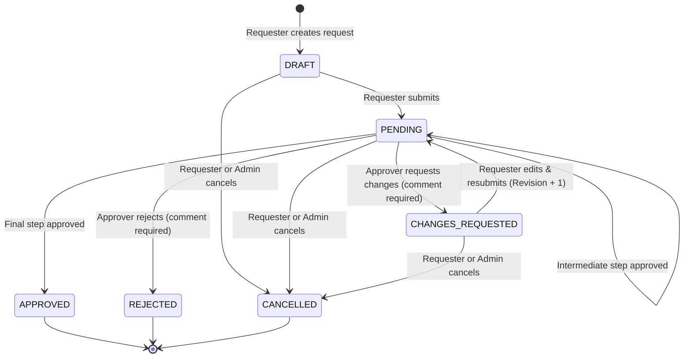

# ApprovalTrail

ApprovalTrail is a configurable request and approval portal built to replace informal approval channels (chat, email, verbal) for leave requests, purchase orders, content publications, and custom corporate workflows. Every decision, modification, and comment is cryptographically preserved in a **tamper-evident SHA-256 hash-chained audit history**.

---

## 1. Prerequisites

- **Node.js**: `v20.x` LTS (or `>=20.0.0`)
- **Package Manager**: `npm` (v10+ recommended)
- **Database**: SQLite (via Prisma 5.22.0)

---

## 2. Setup & Installation

### Quick Start (under 2 minutes)

```bash
# 1. Install dependencies for both server and client workspaces
npm install

# 2. Configure environment variables
# On Windows PowerShell:
Copy-Item server/.env.example server/.env
# On Linux/macOS:
cp server/.env.example server/.env

# 3. Setup database (pushes Prisma schema and runs idempotent seed)
npm run db:setup

# 4. Run test suite (all green)
npm test

# 5. Build for production (verifies TypeScript & Vite bundles)
npm run build

# 6. Start development servers (Backend :4000, Frontend :5173)
npm run dev
```

Visit the application in your browser at: **`http://localhost:5173`**

---

## 3. Demo Accounts

All demo user accounts are pre-seeded with the password: **`Passw0rd!`**

| Name | Email | Role | Manager | Purpose |
|---|---|---|---|---|
| **Admin User** | `admin@demo.com` | `ADMIN` | None | Manage Request Types, Users, Global Audit Verification & CSV Export |
| **Manager User** | `manager@demo.com` | `MANAGER` | None | Direct supervisor for Alice and Bob; approves team requests |
| **Approver User** | `approver@demo.com` | `APPROVER` | None | HR Specialist (Leave) & Finance Officer (Purchases $\ge \$1,000$) |
| **Alice Requester** | `alice@demo.com` | `REQUESTER` | Manager | Submits leave and purchase requests |
| **Bob Requester** | `bob@demo.com` | `REQUESTER` | Manager | Submits requests; tests role separation & self-approval prevention |

*(Tip: The login page includes quick 1-click autofill buttons for these credentials).*

---

## 4. Scripts Overview

| Command | Workspace | Description |
|---|---|---|
| `npm run dev` | Root | Runs backend server on port 4000 and Vite client on port 5173 concurrently |
| `npm run build` | Root | Compiles server with `tsc` and builds frontend with `vite build` |
| `npm test` | Root | Executes backend test suite with Vitest and Supertest |
| `npm run db:setup` | Root | Runs `prisma db push` and `tsx prisma/seed.ts` |
| `npm run dev -w server` | Server | Runs backend with `tsx watch src/index.ts` |
| `npm run build -w server` | Server | Builds server to `dist/` using TypeScript compiler |
| `npm test -w server` | Server | Runs Vitest tests against `file:./test.db` |
| `npm run db:push -w server` | Server | Pushes Prisma schema to SQLite database |
| `npm run db:seed -w server` | Server | Seeds default roles, users, and request types |
| `npm run dev -w client` | Client | Starts Vite development server with proxy to `:4000` |
| `npm run build -w client` | Client | Runs client TypeScript typecheck and builds optimized Vite bundle |

---

## 5. Workflow State Machine

The approval process follows a strict finite-state machine enforced server-side.



### Core Business Rules Enforced Server-Side:
1. **Self-Approval Forbidden (HTTP 403)**: A requester can never approve, reject, or request changes on their own request, even if they hold the assigned approver role or manager position.
2. **Strict RBAC & Step Authorization**: Decisions are strictly restricted to the user or role matched to the active `PENDING` step.
3. **Concurrency Protection (HTTP 409)**: Double-deciding or conflicting decisions on the same step fail with 409 "Step already decided".
4. **Mandatory Comments on Rejections & Revisions**: Rejections and change requests require a minimum 3-character explanation stored in the audit trail.
5. **Conditional Branching**: Steps evaluate conditions against submitted JSON form values (e.g., `amount >= 1000`). If false, the step is marked `SKIPPED`.

---

## 6. Tamper-Evident Audit Trail

Every state change, form submission, revision, step decision, and comment is recorded inside the database transaction.

### Cryptographic Hash Formula
For each log entry, a canonical SHA-256 hash is computed:
```
hash = sha256(prevHash + "|" + seq + "|" + requestId + "|" + actorId + "|" + action + "|" + stableJson(details) + "|" + createdAt.toISOString())
```
- First record uses `prevHash = "GENESIS"`.
- `stableJson` canonicalizes details with sorted keys to ensure exact reproducibility.
- `GET /api/audit/verify` re-computes the hash chain from sequence 1 through the latest record and reports `{ valid: boolean, checked: number, firstBrokenSeq: number | null }`.
- Audit rows cannot be modified or deleted through the API. Direct database alterations immediately break the chain and are flagged by `/api/audit/verify`.

---

## 7. REST API Overview

All API endpoints are prefixed with `/api`. Authentication uses `Authorization: Bearer <jwt>`.

### Error Format
```json
{
  "error": {
    "code": "VALIDATION_ERROR",
    "message": "Human readable description",
    "details": []
  }
}
```

### Endpoints Table

| Method | Path | Access | Purpose |
|---|---|---|---|
| `GET` | `/health` | Public | Healthcheck: `{ "status": "ok" }` |
| `POST` | `/auth/login` | Public (Rate-limited) | Login `{ email, password }` $\rightarrow$ `{ token, user }` |
| `GET` | `/auth/me` | Authenticated | Current authenticated user profile |
| `GET` | `/users` | `ADMIN` | List all users with manager relationships |
| `POST` | `/users` | `ADMIN` | Create user `{ name, email, password, role, managerId? }` |
| `PATCH` | `/users/:id` | `ADMIN` | Update user role, manager, name, or active status |
| `GET` | `/users/approvers` | Authenticated | List approvers for dropdown assignment |
| `GET` | `/request-types` | Authenticated | List active types (`?all=1` for Admin) |
| `GET` | `/request-types/:id` | Authenticated | Request type detail with form schema & steps |
| `POST` | `/request-types` | `ADMIN` | Create new request type with schema & workflow |
| `PUT` | `/request-types/:id` | `ADMIN` | Update/replace request type definition |
| `GET` | `/requests` | Authenticated | List requests (`scope=mine\|all`, `status`, `typeId`, `q`) |
| `POST` | `/requests` | Authenticated | Create `DRAFT` request `{ requestTypeId, title, data }` |
| `GET` | `/requests/:id` | Participants/Admin | Full detail: request, form data, steps, comments, audit logs |
| `PUT` | `/requests/:id` | Requester | Edit request (`DRAFT` or `CHANGES_REQUESTED` only) |
| `POST` | `/requests/:id/submit` | Requester | Transition `DRAFT` $\rightarrow$ `PENDING` |
| `POST` | `/requests/:id/resubmit` | Requester | Resubmit with new revision (`CHANGES_REQUESTED` $\rightarrow$ `PENDING`) |
| `POST` | `/requests/:id/cancel` | Requester, Admin | Cancel request with optional comment |
| `POST` | `/requests/:id/comments` | Participants | Add comment `{ body }` |
| `GET` | `/approvals/inbox` | Authenticated | Requests waiting on the current user's approval |
| `POST` | `/approvals/:requestId/decide` | Matching Approver | Decide `{ decision: "APPROVE"\|"REJECT"\|"REQUEST_CHANGES", comment? }` |
| `GET` | `/audit` | `ADMIN`, `MANAGER` | Filterable global audit log |
| `GET` | `/audit/verify` | `ADMIN` | Cryptographic audit chain verification |
| `GET` | `/audit/export.csv` | `ADMIN` | Injection-safe CSV export of audit records |
| `GET` | `/notifications` | Authenticated | User's notifications list |
| `POST` | `/notifications/read-all` | Authenticated | Mark all notifications read |
| `GET` | `/dashboard/stats` | Authenticated | Status counts, pending-for-me count, turnaround hours |

---

## 8. How to Add a New Request Type

Administrators can add or configure new request types directly from the UI without modifying source code:

1. Log in as an administrator (`admin@demo.com`).
2. Navigate to **Request Types** in the top navigation bar (`/admin/request-types`).
3. Click **"+ New Request Type"**.
4. Set the **Unique Key** (e.g. `EQUIPMENT`) and **Display Name** (e.g. `Hardware Equipment Request`).
5. In **Form Schema Fields**, add your dynamic inputs:
   - Field types: `Text`, `Textarea`, `Number`, `Date`, `Select`, or `Checkbox`.
   - Specify labels, required flags, options (for selects), and min/max limits.
6. In **Approval Workflow Routing**, add sequential review steps:
   - **Step 1**: E.g. `Manager Review` (Approver Kind: `Requester Direct Manager`).
   - **Step 2**: E.g. `IT Security Review` (Approver Kind: `Role`, Role: `APPROVER`).
   - Add optional conditions (e.g. only run Step 2 if `cost` is greater than or equal to `500`).
7. Preview the generated form live in the **Live Form Preview** section.
8. Click **"Save Request Type"**.

The new request type is immediately available on the New Request page for all users!

---

## 9. Known Notes & Architecture Decisions

- **SQLite & Prisma 5 Compatibility**: SQLite in Prisma 5 does not natively support enum or Json types. All enums and JSON structures are modeled as typed strings with runtime validation via Zod schemas and TypeScript string-literal unions.
- **Audit Sequence**: SQLite requires unique autoincrements to be primary keys; to preserve `id String @id @default(cuid())`, the sequential `seq` integer is assigned inside the atomic Prisma `$transaction` as `(max seq) + 1`.
- **CSV Formula Injection Defense**: In the audit log CSV export, all cell values starting with `=`, `+`, `-`, or `@` are safely prefixed with an apostrophe `'` to prevent spreadsheet formula execution exploits.

